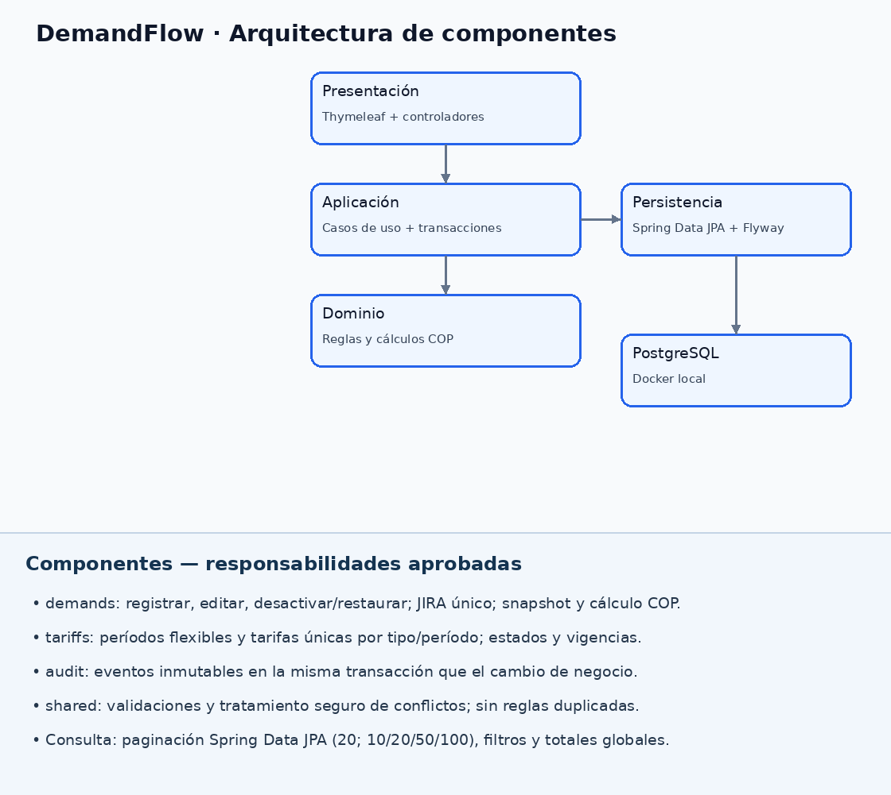

# ADR-001: Monolito modular con arquitectura en capas pragmática

**Estado:** Aceptado  
**Fecha:** 2026-11-13  
**Ámbito:** DemandFlow v1.0  
**Tipo:** Decisión arquitectónica

## 1. Contexto

DemandFlow es una aplicación web para administrar demandas de ingeniería de tipo **Soporte** y **Feature**, tarifas por vigencia, horas estimadas y contratadas, importes COP y auditoría. Su objetivo también es facilitar el aprendizaje progresivo de Java y Spring Boot. El diseño debe proteger las reglas de negocio y el histórico sin imponer complejidad técnica innecesaria.

## 2. Decisión aceptada

Construir **una sola aplicación Spring Boot (monolito modular)**, organizada **por funcionalidad** y con **capas pragmáticas** dentro de cada área. No se implementarán microservicios, API Gateway, mensajería distribuida ni Clean Architecture estricta con módulos y puertos obligatorios.

Organización **orientativa**, no estructura creada todavía:

```text
src/main/java/com/demandflow/
├── DemandFlowApplication.java
├── demands/
│   ├── web/
│   ├── application/
│   ├── domain/
│   └── persistence/
├── tariffs/
│   ├── web/
│   ├── application/
│   ├── domain/
│   └── persistence/
├── audit/
└── shared/
```

Solo se crearán paquetes cuando exista código que lo justifique. `shared/` no será un depósito de clases sin dueño. Las consultas y totales pueden pertenecer a `demands` inicialmente; separar un módulo `queries` requerirá una necesidad real.

### Responsabilidades

| Área | Responsabilidad | No debe hacer |
|---|---|---|
| `web` | Controladores, formularios, DTO, respuestas y validación de entrada | Calcular importes o ejecutar consultas de persistencia directamente |
| `application` | Casos de uso, transacciones, coordinación de auditoría | Incluir lógica de presentación |
| `domain` | Reglas e invariantes: tarifa aplicada, horas, cálculo, estados | Depender de Thymeleaf o controladores |
| `persistence` | JPA, repositorios, mapeos y consultas | Decidir reglas de negocio por sí sola |

**Dependencias:** el flujo de ejecución típico es `web → application → domain`, mientras que `application` utiliza persistencia. Se evitará que `domain` dependa de `web` o de detalles de infraestructura. No se exigirán interfaces para cada clase; se introducirán cuando faciliten una prueba, un límite real o una sustitución justificada.



[Diagrama editable en Excalidraw](../architecture/diagrams/components.excalidraw)

> El diagrama existente es conceptual. La implementación deberá precisar las dependencias reales sin interpretar la infraestructura como una capa de negocio inferior al dominio.

## 3. Alternativas consideradas (no seleccionadas)

| Alternativa | Evaluación |
|---|---|
| Microservicios | Exigen despliegue, observabilidad y comunicación distribuidos sin beneficio para el MVP. |
| Clean Architecture estricta con varios proyectos y puertos por clase | Aumenta abstracciones y carga de aprendizaje antes de necesitarlas. |
| Capas globales sin módulos funcionales (`controllers/`, `services/`, `repositories/`) | Simples al principio, pero pueden dispersar el código de una misma funcionalidad. |
| Monolito modular con capas pragmáticas | **Seleccionado:** equilibrio entre claridad, separación y simplicidad. |

## 4. Justificación

Permite evolucionar DemandFlow con un solo proceso y un único ciclo de despliegue; mantiene cercanas las clases de cada funcionalidad, facilita localizar las reglas de negocio y habilita pruebas aisladas sin imponer infraestructura distribuida.

## 5. Consecuencias y compromisos

**Beneficios:** menor complejidad operativa; aprendizaje gradual; límites claros entre presentación, aplicación, dominio y persistencia; despliegue y depuración sencillos.

**Riesgos:** acoplamiento entre funcionalidades, crecimiento de `shared/` y servicios con demasiadas responsabilidades. Se mitigarán con revisiones de dependencias, pruebas y refactorizaciones pequeñas.

## 6. Buenas prácticas de implementación

### 6.1. Diseño y mantenibilidad
- Aplicar **KISS**, **YAGNI**, **DRY** y **SOLID** con criterio; no crear abstracciones especulativas.
- Una responsabilidad principal por clase y nombres explícitos de casos de uso.
- Controladores delgados; reglas económicas en el dominio y coordinación transaccional en aplicación.
- Evitar dependencias circulares entre paquetes y acceso directo desde web a repositorios.
- Usar `BigDecimal` para horas y dinero; la escala y el redondeo se definirán antes de implementar.
- Centralizar reglas de unicidad, vigencias y preservación de tarifa histórica en operaciones verificables.
- Mantener la auditoría dentro de la misma transacción que la modificación de datos.

### 6.2. Seguridad y OWASP
- Validar datos en servidor y aplicar restricciones de base de datos donde corresponda.
- No confiar en datos ocultos del formulario ni en validaciones del navegador.
- Evitar SQL construido mediante concatenación; preferir consultas parametrizadas.
- Escapar datos al mostrarlos; proteger operaciones de modificación contra CSRF.
- No registrar secretos ni exponer trazas internas al usuario.
- **Sin autenticación en el MVP, no exponer DemandFlow públicamente.** El control de acceso deberá diseñarse antes de un despliegue compartido.

### 6.3. Pruebas y evolución
- Probar reglas del dominio sin necesidad de iniciar el servidor web cuando sea posible.
- Probar transacciones, integridad y consultas contra PostgreSQL.
- Añadir pruebas de regresión para cada regla económica modificada.
- Refactorizar solo con evidencia de necesidad y pruebas que protejan el comportamiento.

## 7. Criterios de verificación

La implementación de esta decisión se comprobará cuando:

- [ ] Exista una sola aplicación Spring Boot y una organización reconocible por funcionalidad.
- [ ] Los controladores deleguen en operaciones de aplicación.
- [ ] Los cálculos y reglas de negocio no estén en plantillas ni controladores.
- [ ] El dominio no dependa de presentación ni de detalles de persistencia innecesarios.
- [ ] No existan dependencias circulares ni interfaces sin propósito claro.
- [ ] Las modificaciones económicas y sus eventos de auditoría sean atómicos.
- [ ] Existan pruebas de dominio e integración para reglas críticas.
- [ ] La aplicación sin autenticación esté limitada al entorno local protegido.

## 8. Referencias internas

- `docs/architecture/architecture.md`
- `docs/architecture/data-model.md`
- `docs/engineering/coding-standards.md`
- `docs/engineering/testing-strategy.md`
- `docs/engineering/security-standards.md`
- ADR-002: plataforma Java y Spring Boot.
- ADR-006: auditoría e histórico (Aceptado).

## 9. Estado de la decisión

**Aceptado.** La aprobación corresponde al estilo arquitectónico y a la organización por funcionalidades. Los criterios de verificación describen condiciones futuras de implementación; no indican que ya exista código.
