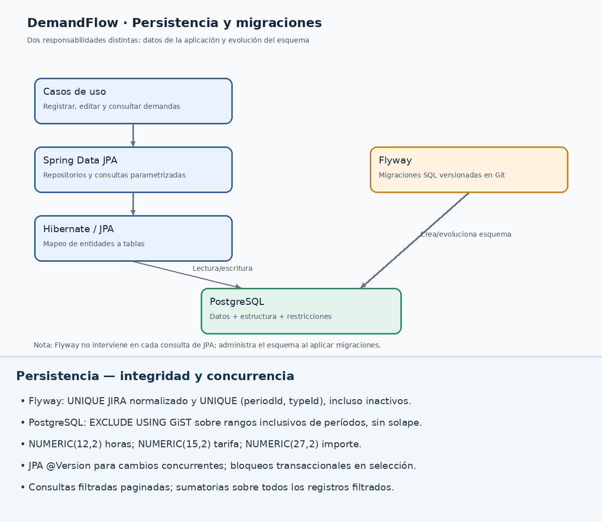

# ADR-004: Spring Data JPA, Hibernate y Flyway

**Estado:** Aceptado  
**Fecha:** 2026-11-13
**Ámbito:** DemandFlow v1.0  

## 1. Contexto

DemandFlow es un monolito modular desarrollado con Java 21, Spring Boot y Maven (ADR-001 y ADR-002), que utiliza PostgreSQL en Docker Compose (ADR-003). Gestiona demandas de ingeniería, vigencias tarifarias, tarifas, importes en COP y auditoría. Requiere persistencia fiable, restricciones de integridad, trazabilidad de cambios y evolución controlada del esquema.

La solución debe ser suficientemente sencilla para aprender Java y Spring Boot, sin renunciar a la corrección de cálculos económicos y operaciones transaccionales.

## 2. Decisión aceptada

Utilizar **Spring Data JPA** para repositorios y consultas, **Hibernate** como implementación de Jakarta Persistence (JPA), y **Flyway** para administrar las migraciones versionadas de PostgreSQL.

- Spring Data JPA reduce código repetitivo en acceso a datos.
- Hibernate realiza el mapeo entre entidades de persistencia y tablas.
- Flyway define y ejecuta cambios del esquema, versionados en Git.
- El esquema se administra mediante Flyway; Hibernate **valida** la correspondencia con las entidades, pero no crea ni altera tablas automáticamente en entornos compartidos.
- Spring gestiona las transacciones de los casos de uso que modifican datos.

No se implementará una segunda capa de repositorios abstractos sin necesidad concreta; la separación entre dominio y persistencia se mantendrá pragmática, conforme a ADR-001.

## 3. Alternativas consideradas

| Alternativa | Evaluación |
|---|---|
| JDBC directo | Ofrece control SQL explícito, pero requiere más código repetitivo para el MVP. |
| MyBatis | Es válido para SQL explícito, pero introduce otra herramienta de aprendizaje. |
| Hibernate sin Spring Data JPA | Es viable, con mayor configuración y código de repositorios. |
| Liquibase | Alternativa sólida para migraciones; no se necesita usarla junto a Flyway. |
| Generación automática de esquema por Hibernate | Conveniente para prototipos desechables, pero no sustituye migraciones versionadas y revisables. |

Las alternativas no seleccionadas son **documentales**, no componentes de la solución.

## 4. Justificación

La combinación elegida aprovecha el ecosistema Spring Boot, permite enfocarse en reglas de negocio y mantiene separados el acceso a datos y la evolución del esquema. PostgreSQL seguirá siendo la fuente de verdad para restricciones críticas, incluso cuando exista validación previa en Java.

## 5. Consecuencias y compromisos

**Beneficios:** menos código de persistencia repetitivo; consultas y repositorios integrados con Spring; migraciones reproducibles; pruebas de integración contra el motor real; operaciones transaccionales.

**Compromisos:** comprender el ciclo de vida de entidades JPA, carga perezosa, transacciones, consultas N+1 y estrategias de mapeo; revisar migraciones antes de aplicarlas; evitar que la facilidad de usar JPA oculte consultas ineficientes.

## 6. Buenas prácticas de implementación

### 6.1. Repositorios y separación de responsabilidades

- Mantener controladores ligeros; los casos de uso coordinan validaciones, persistencia y auditoría.
- Evitar reglas económicas dentro de controladores, plantillas o consultas SQL cuando deban expresarse en el dominio.
- No exponer entidades JPA directamente como modelos de entrada de formularios; utilizar DTO de entrada y salida.
- Introducir interfaces adicionales solo cuando resuelvan una dependencia real o faciliten pruebas significativas.
- Evitar relaciones bidireccionales y cascadas indiscriminadas; definir explícitamente sus efectos.

### 6.2. Integridad de datos

- Crear claves primarias y foráneas y restricciones `UNIQUE`, `NOT NULL` y `CHECK` cuando corresponda.
- Aplicar unicidad de JIRA **sin distinguir mayúsculas/minúsculas**, incluso para demandas inactivas, mediante una estrategia explícita de normalización e índice/restricción en PostgreSQL.
- Garantizar que no existan vigencias tarifarias superpuestas; definir y probar un mecanismo seguro ante concurrencia.
- Definir unicidad de tarifa por tipo y vigencia, según el modelo aprobado.
- Al registrar demandas, verificar que la tarifa y la vigencia estén activas.
- Conservar el valor de tarifa aplicado como **snapshot** dentro de la demanda; una corrección del catálogo no recalcula importes históricos.
- No realizar borrados físicos de registros que deban permanecer en el histórico.

### 6.3. Precisión económica

- Usar `BigDecimal` en Java y `NUMERIC` en PostgreSQL para horas, tarifas e importes.
- No usar `float` ni `double` para cálculos económicos.
- Definir formalmente escala, precisión y política de redondeo **antes de implementar**; estos detalles siguen pendientes en la línea base funcional.
- Calcular el importe como horas contratadas multiplicadas por la tarifa aplicada.
- Si cambian solo las horas, recalcular con la tarifa histórica guardada; si cambian tipo o vigencia, obtener la nueva tarifa activa y auditar el cambio.

### 6.4. Transacciones y concurrencia

- Ejecutar en una misma transacción la modificación de una demanda y su evento de auditoría.
- Si falla la auditoría o la persistencia, revertir la operación completa.
- No confiar exclusivamente en verificaciones previas de existencia: respaldarlas con restricciones en PostgreSQL.
- Definir el manejo de conflictos concurrentes y errores de integridad mediante respuestas comprensibles y seguras.
- Mantener las transacciones acotadas; no incluir operaciones externas lentas dentro de ellas.

### 6.5. Migraciones Flyway

- Versionar las migraciones en Git y ejecutarlas en orden controlado.
- No editar una migración ya aplicada en un entorno compartido; generar una nueva migración correctiva.
- Evitar cambios manuales de esquema fuera del proceso versionado.
- Configurar la validación del esquema por Hibernate, sin depender de `ddl-auto=update` para evolución.
- Revisar cambios destructivos y planificar respaldo y recuperación antes de aplicarlos.

### 6.6. Consultas y rendimiento

- Evitar N+1 mediante consultas apropiadas, proyecciones o estrategias de carga explícitas.
- Paginar listados extensos, sin limitar los **totales agregados** a la página actual: deben calcularse sobre todo el conjunto filtrado.
- Consultar únicamente las columnas necesarias cuando sea razonable.
- Añadir índices a partir de restricciones y patrones reales de búsqueda, no indiscriminadamente.
- Medir antes de optimizar; evitar complejidad prematura.

### 6.7. Seguridad y OWASP

- Utilizar parámetros enlazados mediante JPA o consultas parametrizadas; nunca concatenar entradas del usuario para construir SQL.
- Validar en servidor todos los datos provenientes de formularios.
- Prevenir asignación masiva de campos sensibles: la tarifa histórica, el importe calculado y los metadatos de auditoría los determina el servidor.
- No registrar credenciales ni datos sensibles en mensajes de error o logs.
- Aplicar mínimos privilegios a la cuenta de PostgreSQL y mantener secretos fuera del repositorio.
- La ausencia de autenticación en el MVP exige restringir el despliegue a un entorno local o protegido; no publicarlo en Internet.

### 6.8. Pruebas

- Probar los repositorios y migraciones con PostgreSQL real en un entorno de pruebas aislado.
- Verificar restricciones de unicidad, relaciones, vigencias superpuestas y concurrencia.
- Comprobar que los cambios de demanda y auditoría se confirman o revierten conjuntamente.
- Probar snapshot tarifario, cambios de horas, cambios de tipo/vigencia y desactivación/restauración.
- Probar consultas filtradas y agregaciones independientes de la paginación.

## 7. Criterios de verificación

- [ ] Flyway crea y evoluciona el esquema de PostgreSQL correctamente.
- [ ] Hibernate valida el esquema sin modificarlo automáticamente.
- [ ] La unicidad de JIRA se cumple, incluso entre registros inactivos y con diferencias de mayúsculas.
- [ ] Las vigencias no pueden superponerse, incluso ante operaciones concurrentes.
- [ ] Los valores monetarios usan tipos exactos y la política de redondeo aprobada.
- [ ] Los cambios de demandas y su auditoría son atómicos.
- [ ] Se conserva la tarifa histórica aplicada y no se recalcula por cambios posteriores del catálogo.
- [ ] Las consultas y agregaciones respetan todos los filtros y la paginación no altera los totales.
- [ ] Las entradas del usuario no se concatenan en consultas SQL.
- [ ] Los formularios no pueden modificar campos de cálculo o auditoría reservados al servidor.
- [ ] Las pruebas de integración relevantes se ejecutan contra PostgreSQL.

## 8. Impacto en la arquitectura y diagramas

Este ADR introduce dos responsabilidades complementarias y separadas: **Spring Data JPA / Hibernate** para las operaciones de persistencia y **Flyway** para las migraciones del esquema de PostgreSQL. La arquitectura general documenta ambos flujos sin representar Flyway como parte de cada consulta.

[Editar diagrama de persistencia en Excalidraw](../architecture/diagrams/persistence.excalidraw)

El archivo fuente del diagrama se mantiene únicamente en `docs/architecture/diagrams/`. Cualquier cambio posterior debe reflejarse en `docs/architecture/architecture.md` y en este ADR cuando afecte a la decisión aceptada.

## 9. Referencias internas

- `docs/architecture/architecture.md`
- `docs/architecture/data-model.md`
- `docs/architecture-decisions/ADR-001-architectural-style.md`
- `docs/architecture-decisions/ADR-002-java-spring.md`
- `docs/architecture-decisions/ADR-003-postgresql-docker.md`
- `docs/engineering/coding-standards.md`
- `docs/engineering/testing-strategy.md`
- `docs/engineering/security-standards.md`
- `docs/requirements/functional-requirements.md`

## 10. Estado de la decisión

**Aceptado.** La implementación y sus verificaciones están pendientes. La aprobación del ADR no implica que se hayan creado migraciones, repositorios o código Java.
