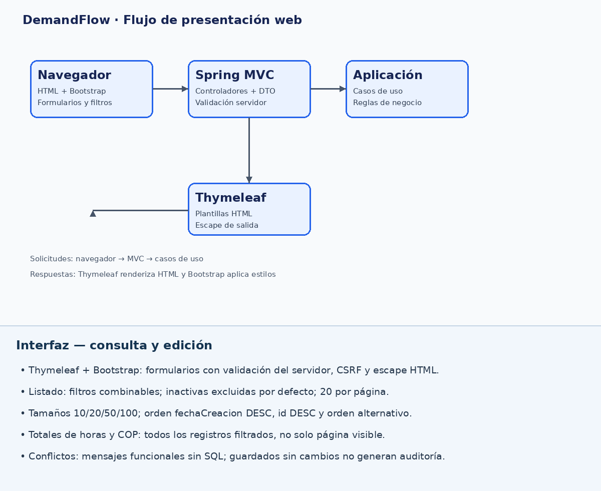

# ADR-005: Spring MVC, Thymeleaf y Bootstrap

**Estado:** Aceptado  
**Fecha:** 2026-11-13
**Ámbito:** DemandFlow v1.0  

## 1. Contexto
DemandFlow es un MVP educativo con formularios para demandas, tarifas y vigencias, consultas filtradas, totales y auditoría. La interfaz debe ser accesible, segura y sencilla de mantener. El propósito es aprender Java y Spring Boot sin introducir un frontend independiente.

## 2. Decisión propuesta
Construir una **aplicación web renderizada en el servidor** con **Spring MVC**, **Thymeleaf** y **Bootstrap**. Utilizar JavaScript únicamente para mejoras puntuales de experiencia de usuario; las reglas de negocio se validan y ejecutan en el servidor.

- **Spring MVC:** rutas HTTP, controladores, validación y coordinación con casos de uso.
- **Thymeleaf:** plantillas HTML renderizadas en servidor y escape de salida por defecto con `th:text`.
- **Bootstrap:** diseño responsive y componentes visuales accesibles cuando se usen correctamente.
- **JavaScript:** interacciones opcionales; no constituye una segunda aplicación.

La aplicación se ejecutará en el mismo proceso Spring Boot definido por ADR-001 y ADR-002.

## 3. Alternativas consideradas (no seleccionadas)
| Alternativa | Evaluación |
|---|---|
| SPA React/Angular/Vue | Exige otra herramienta, pipeline y contratos API para un MVP de formularios. |
| API REST y frontend separado | Aumenta despliegue y coordinación sin necesidad funcional actual. |
| HTML sin plantillas de servidor | Duplica composición de páginas y dificulta el manejo de formularios. |

## 4. Justificación
Esta combinación reduce la complejidad, favorece el aprendizaje de Spring MVC y permite implementar las pantallas del MVP con un solo proyecto. La presentación permanece separada de los casos de uso y de las reglas económicas.

## 5. Consecuencias y compromisos
**Beneficios:** una aplicación desplegable; formularios y validaciones integrados; menos herramientas; pruebas MVC directas.  
**Compromisos:** menor dinamismo que una SPA; renderizado completo de páginas en algunos flujos; el uso de componentes interactivos debe justificarse.

## 6. Buenas prácticas de implementación

### 6.1 Separación de responsabilidades
- Mantener controladores ligeros: transformar entradas, invocar casos de uso y seleccionar vista o redirección.
- No calcular tarifas ni tomar decisiones de negocio en controladores, plantillas o JavaScript.
- Utilizar objetos de formulario/DTO con campos permitidos; no enlazar directamente entidades JPA a solicitudes HTTP.
- Organizar controladores, formularios y vistas por funcionalidad, conforme a ADR-001.

### 6.2 Formularios y navegación
- Aplicar **Bean Validation** y validaciones de negocio en servidor; la validación del navegador solo mejora la experiencia.
- Utilizar **Post/Redirect/Get** tras operaciones exitosas; mostrar errores de validación en la misma vista sin perder datos válidos.
- Proteger frente a duplicados con unicidad en PostgreSQL y tratamiento adecuado de concurrencia: PRG por sí solo no garantiza idempotencia.
- Mantener filtros y paginación mediante parámetros de consulta; calcular totales sobre todos los registros filtrados, no solo la página.
- Mostrar claramente el tipo de demanda, vigencia, tarifa aplicada y cantidades monetarias; los cálculos definitivos ocurren en servidor.

### 6.3 Seguridad — OWASP Top 10
- Escapar valores no confiables mediante `th:text`; evitar `th:utext` con contenido no sanitizado.
- Proteger operaciones que cambian estado contra **CSRF** con la configuración y tokens adecuados de Spring Security, incluso si no hay login.
- No confiar en campos ocultos para autorizar cambios en tarifa, vigencia o auditoría; validar en casos de uso.
- Evitar incluir secretos o trazas internas en HTML, mensajes de error o logs.
- Establecer encabezados de seguridad y una política de recursos compatible con Bootstrap (CSP a definir y probar).
- **Sin autenticación ni autorización por usuario, el MVP no se expondrá públicamente.** CSRF no reemplaza control de acceso.

### 6.4 Accesibilidad y mantenimiento
- Asociar etiquetas a controles, marcar campos obligatorios y presentar errores junto a cada campo.
- Garantizar navegación por teclado, foco visible, contraste suficiente y tablas con encabezados semánticos.
- Usar fragmentos Thymeleaf para navegación y componentes repetidos sin crear una biblioteca de componentes prematura.
- Preferir dependencias frontend locales/versionadas o una política explícita para recursos externos.

### 6.5 Pruebas
- Pruebas MVC con Spring MVC Test para rutas, validaciones, respuestas, redirecciones y manejo de errores.
- Verificar escape de HTML, protección CSRF y campos que no deben poder modificarse mediante formularios.
- Pruebas de aceptación para registrar/editar/desactivar demandas, tarifas y vigencias, consultar filtros y totales.

## 7. Impacto en la arquitectura y diagramas
La capa **Web** del monolito contiene controladores Spring MVC, DTO/formularios y plantillas Thymeleaf; delega en la capa de aplicación. Bootstrap da estilo al HTML entregado al navegador.

[Editar diagrama en Excalidraw](../architecture/diagrams/presentation.excalidraw)

El diagrama se almacena una sola vez en `docs/architecture/diagrams/` y también debe referenciarse desde `architecture.md`.

## 8. Criterios de verificación
- [ ] Formularios y tablas funcionan en escritorio y móvil.
- [ ] Los controladores delegan la lógica de negocio a casos de uso.
- [ ] Se validan entradas en servidor y se muestran errores útiles.
- [ ] Las operaciones exitosas usan Post/Redirect/Get.
- [ ] Los formularios que cambian estado están protegidos contra CSRF.
- [ ] Los datos mostrados se escapan correctamente para prevenir XSS.
- [ ] No se pueden modificar campos protegidos mediante manipulación de solicitudes.
- [ ] Filtros, paginación y totales respetan las reglas funcionales.
- [ ] Existen pruebas MVC para los flujos críticos.
- [ ] La aplicación sin autenticación permanece restringida al entorno local protegido.

## 9. Referencias internas
- `docs/architecture/architecture.md`
- `docs/engineering/security-standards.md`
- `docs/engineering/testing-strategy.md`
- ADR-001: monolito modular y capas pragmáticas.
- ADR-002: Java 21, Spring Boot y Maven.
- ADR-004: JPA, Hibernate y Flyway.

## 10. Estado de la decisión
**Aceptado.** La elección de Spring MVC, Thymeleaf y Bootstrap está aprobada; la implementación y sus pruebas siguen pendientes.
