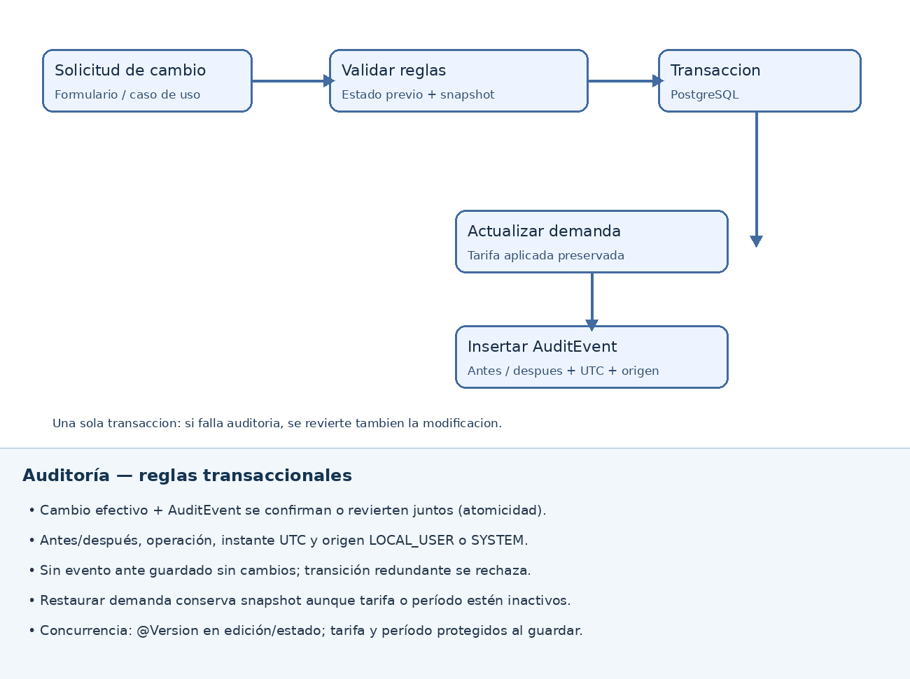

# ADR-006: Snapshot monetario y auditoría transaccional

**Estado:** Aceptado
**Fecha:** 2026-11-13
**Ámbito:** DemandFlow v1.0  

## 1. Contexto y problema
DemandFlow registra demandas con horas contratadas, tarifa por tipo y período y un importe en COP. El catálogo tarifario puede cambiar o desactivarse, mientras que las demandas históricas deben conservar el valor aplicado. Las modificaciones de datos relevantes necesitan trazabilidad verificable sin introducir infraestructura desproporcionada para el MVP.

Se requieren dos propiedades distintas: **estabilidad del cálculo histórico** (snapshot) y **explicabilidad de los cambios** (auditoría). Una no sustituye a la otra.

## 2. Decisión propuesta
1. Al crear una demanda, persistir el valor de la **tarifa horaria aplicada** junto con los datos necesarios para identificar el período/tipo utilizados.
2. Calcular el importe como `horas_contratadas × tarifa_aplicada`, con aritmética decimal exacta (`BigDecimal`/`NUMERIC`). La precisión, escala y política de redondeo se fijarán antes de implementar.
3. Si cambian únicamente las horas contratadas, **mantener** la tarifa aplicada almacenada y recalcular el importe.
4. Si cambia el tipo o el período, validar la tarifa activa correspondiente, tomar un **nuevo snapshot**, recalcular y auditar los valores anteriores y nuevos.
5. Registrar un **evento de auditoría** en altas, modificaciones, bajas lógicas, restauraciones y cambios relevantes de tarifas/períodos. Los eventos serán de solo adición desde los casos de uso ordinarios.
6. Ejecutar la modificación de negocio y la inserción del evento de auditoría **en una misma transacción de base de datos**. Si cualquiera falla, ambas operaciones se revierten.
7. Mantener bajas lógicas y restauraciones sin eliminar el historial.
8. Registrar el origen `LOCAL_USER` o `SYSTEM` en el MVP, sin atribuir identidades personales inexistentes. Registrar instantes en UTC.

## 3. Modelo lógico mínimo del evento
El registro debe permitir consultar al menos: identificador único del evento; tipo e identificador de entidad; tipo de operación; instante UTC; origen; valores anteriores y posteriores de los campos relevantes. El formato exacto de almacenamiento (columnas tipadas y/o JSONB) se concretará en el modelo físico, sin comprometer la legibilidad ni la posibilidad de consultar los cambios.

Los eventos de creación pueden no tener estado anterior y los de baja lógica registran la transición de estado. Evitar secretos, credenciales y datos personales innecesarios en los valores auditados. No usar los logs de aplicación como único registro histórico.

## 4. Flujo transaccional y límites
El caso de uso carga el estado actual, valida invariantes, calcula el estado nuevo, persiste el cambio y agrega el evento en una misma transacción Spring/PostgreSQL. La transacción se confirma solo si ambos registros se escriben correctamente. La presentación no construye ni manipula directamente eventos de auditoría.

En modificaciones concurrentes, evaluar **bloqueo optimista mediante versión** para impedir actualizaciones perdidas; definir el tratamiento de conflictos antes de implementar. Los controles de integridad de ADR-004 continúan aplicando.

## 5. Alternativas consideradas
| Alternativa | Evaluación |
|---|---|
| Recalcular siempre desde el catálogo actual | Rechazada: altera importes históricos cuando cambian tarifas. |
| Registrar únicamente logs técnicos | Rechazada: los logs no garantizan un histórico estructurado, consultable y transaccional. |
| Auditar mediante procesos asíncronos separados | No elegida para el MVP: puede introducir inconsistencias si el evento falla después de guardar la entidad. |
| Event sourcing completo | No elegido: complejidad innecesaria para el alcance actual. |
| Triggers de auditoría en PostgreSQL | Alternativa válida a reevaluar para cobertura de escrituras externas; no se adopta inicialmente porque el MVP centraliza escrituras en casos de uso. |

## 6. Justificación
El snapshot desacopla el importe aplicado del catálogo mutable. La auditoría estructurada permite explicar modificaciones. La atomicidad impide que existan cambios confirmados sin su evento asociado en los flujos de aplicación. El diseño respeta el monolito modular de ADR-001 y la persistencia de ADR-004.

## 7. Consecuencias y compromisos
**Beneficios:** importes históricos estables, cambios rastreables, rollback consistente y consultas de historial. **Costes:** almacenamiento adicional, disciplina de auditoría en cada caso de uso, pruebas de concurrencia y definición del esquema de eventos. **Límites:** los eventos de solo adición desde la aplicación no son una garantía criptográfica ni impiden alteraciones por administradores de base de datos; accesos directos externos quedan fuera del mecanismo propuesto.

## 8. Buenas prácticas y controles
- Centralizar la auditoría en la capa de aplicación, sin lógica de negocio en controladores o plantillas.
- Mantener la operación económica y el evento en una única transacción; no silenciar fallos de auditoría.
- Validar y limitar los datos incluidos en el evento, evitando información sensible innecesaria.
- No permitir edición/borrado ordinario de eventos; aplicar permisos mínimos en la base de datos cuando se configure el entorno.
- Usar `BigDecimal` y `NUMERIC` para tarifas, horas e importes; nunca `float` o `double` para cálculos económicos.
- Asegurar que desactivar/reactivar tarifas o períodos no modifica snapshots previos.
- Preparar índices de consulta por entidad, identificador y tiempo según necesidades verificadas.
- Mantener trazabilidad entre requisitos funcionales, casos de uso, pruebas y eventos.

## 9. Pruebas y criterios de verificación
- Crear una demanda y comprobar que persiste la tarifa aplicada y su evento.
- Cambiar una tarifa del catálogo y comprobar que las demandas existentes conservan tarifa e importe.
- Modificar solo horas y verificar el cálculo con el snapshot original y el evento antes/después.
- Cambiar tipo o período y verificar nueva tarifa válida, nuevo snapshot y auditoría.
- Forzar fallo al insertar el evento y comprobar **rollback completo** de la modificación.
- Forzar fallo de la modificación y comprobar que no queda un evento huérfano.
- Desactivar/restaurar y comprobar preservación del histórico y eventos correspondientes.
- Verificar instantes UTC, origen y ausencia de datos sensibles no necesarios.
- Simular modificaciones concurrentes y comprobar que no se pierden cambios silenciosamente.
- Comprobar que los flujos ordinarios no permiten alterar eventos anteriores.

## 10. Impacto en la arquitectura y diagramas
- `docs/architecture/architecture.md`: agregar sección acumulativa de auditoría e integridad histórica sin reemplazar ADR-001 a ADR-005.
- `docs/architecture/diagrams/audit-transaction.excalidraw`: fuente editable del flujo.
- `docs/architecture/diagrams/audit-transaction.png`: vista previa del mismo flujo.
- `docs/architecture/data-model.md`: actualizado sobre la versión incluida en el ZIP de revisión, con un complemento de auditoría y referencias al diagrama transaccional.
- Relación con ADR-004: la transacción y las restricciones de PostgreSQL siguen siendo las definidas allí.

[Editar en Excalidraw](../architecture/diagrams/audit-transaction.excalidraw)

## 11. Aspectos pendientes de especificación
Precisar escala/precisión de horas y COP, redondeo, formato definitivo de eventos, política de retención, manejo de conflictos concurrentes y reglas exactas de edición/reactivación. No inferir estas reglas a partir de este ADR.

## 12. Estado y aprobación
**Aceptado.** La estrategia de snapshot y auditoría transaccional está aprobada. Los detalles funcionales abiertos deben resolverse antes de implementar; esta aprobación no autoriza por sí sola iniciar Java, Docker u OpenSpec.
