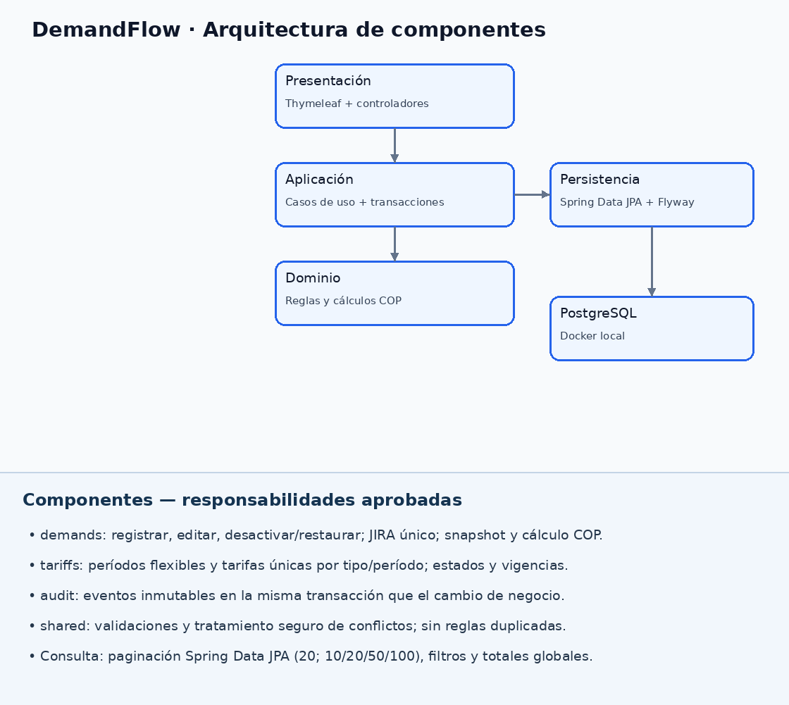
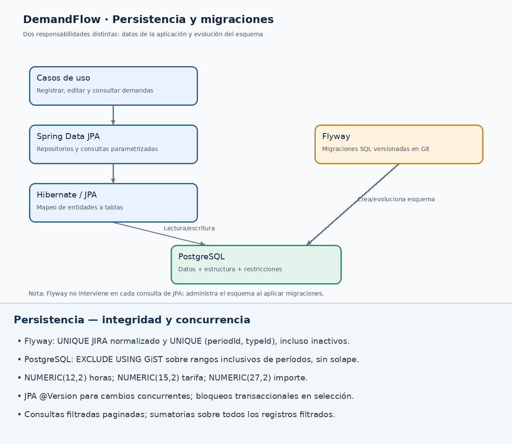
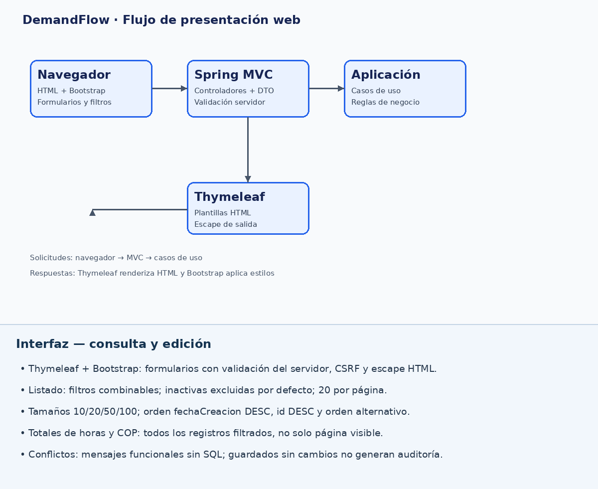
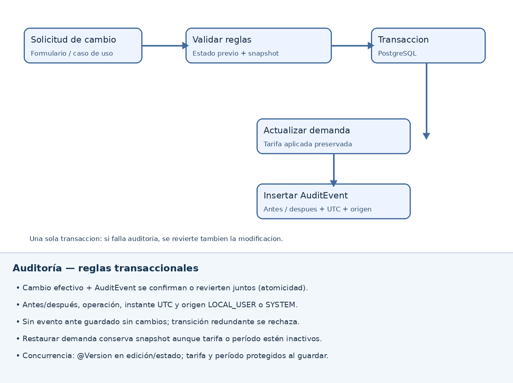
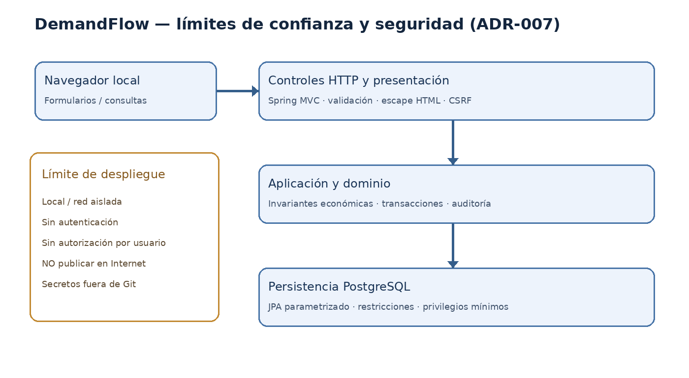
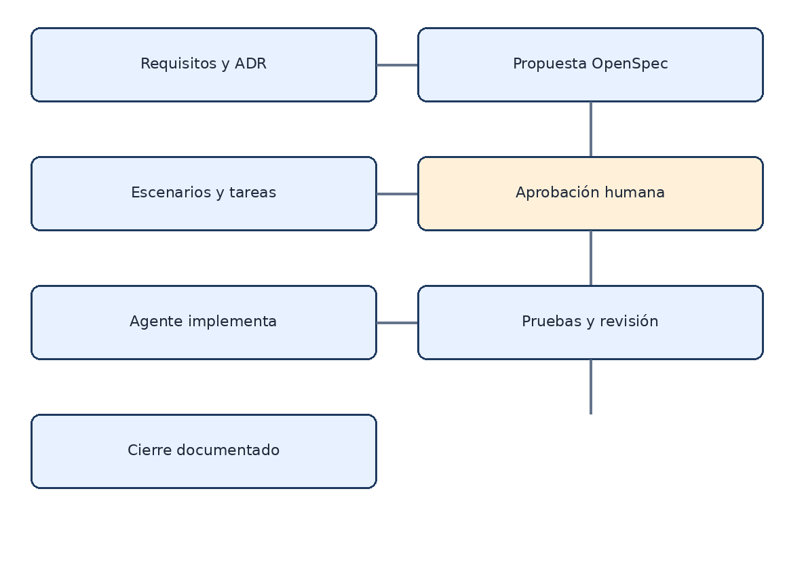

# Arquitectura propuesta — DemandFlow
**Estado:** arquitectura ADR-001 a ADR-008 aceptada. Reglas funcionales refinadas; consolidación documental pendiente de aprobación formal. Implementación no iniciada.

[Editar diagrama en Excalidraw](diagrams/components.excalidraw)

## Persistencia y evolución del esquema (ADR-004)

[Editar diagrama de persistencia en Excalidraw](diagrams/persistence.excalidraw)

**Flujo de datos:** los casos de uso utilizan repositorios Spring Data JPA; Hibernate implementa el mapeo JPA y ejecuta las operaciones sobre PostgreSQL. **Flujo de esquema:** Flyway aplica migraciones versionadas a PostgreSQL, de manera independiente de las consultas ordinarias de JPA. Hibernate valida el esquema; Flyway lo crea y modifica.

Las modificaciones de demandas y sus eventos de auditoría deben realizarse en una transacción. Se conservan los snapshots de tarifas aplicadas. Las restricciones críticas (JIRA único incluso inactivo, integridad referencial y no superposición de vigencias) se verifican también en PostgreSQL. Los detalles de implementación y las pruebas se describen en [ADR-004](../architecture-decisions/ADR-004-jpa-flyway.md).

## Estilo
Monolito modular, un despliegue Spring Boot. Organización por funcionalidad (`tariffs`, `demands`, `audit`, `queries`) con separación interna pragmática: web → aplicación → dominio; adaptadores de persistencia hacia PostgreSQL. Evitar arquitectura hexagonal ceremonial, buses, CQRS y microservicios.

## Responsabilidades
- **Web:** formularios Thymeleaf, controladores, DTO de entrada/salida, validación y mensajes seguros.
- **Aplicación:** casos de uso transaccionales, autorización futura, coordinación de reglas y auditoría.
- **Dominio:** invariantes, cálculos con decimal exacto y reglas sin dependencia de UI.
- **Persistencia:** repositorios Spring Data JPA, restricciones, mapeo y migraciones Flyway.
- **PostgreSQL:** fuente de verdad, integridad, unicidad y transacciones.

## Flujos
1. Alta de demanda: validar datos → validar ID único → recuperar tarifa activa de tipo/vigencia → calcular → guardar demanda y evento en una transacción.
2. Modificar horas: recuperar tarifa aplicada guardada → recalcular → registrar diferencias y evento.
3. Cambiar tipo/vigencia: validar tarifa activa destino → aplicar nueva tarifa → recalcular → auditar.
4. Desactivar tarifa/vigencia: impedir uso futuro, mantener demanda histórica intacta.

## Dependencias
Las reglas de negocio no deben depender de controladores o plantillas. El dominio puede ser Java simple; usar Spring donde aporte valor sin crear abstracciones artificiales.

## Despliegue
Aplicación en entorno local protegido; PostgreSQL en Docker. Sin autenticación, **no publicar en Internet**.

## Riesgos
- Concurrencia: restricción única en base de datos además de validación de aplicación.
- Cambios tarifarios: guardar snapshot de valor aplicado.
- Auditoría: evento y mutación deben confirmarse o revertirse juntos.
- Evolución: migraciones versionadas y pruebas de regresión.

## Presentación web (ADR-005, Aceptado)

[Editar diagrama de presentación en Excalidraw](diagrams/presentation.excalidraw)

El navegador envía formularios y consultas a controladores Spring MVC. Los controladores validan los datos de entrada y delegan en casos de uso; Thymeleaf renderiza las respuestas HTML y Bootstrap aporta el estilo. Las reglas económicas no se implementan en las plantillas ni en JavaScript. Para operaciones con cambios se contemplan CSRF, Post/Redirect/Get y validación del servidor. Véase [ADR-005](../architecture-decisions/ADR-005-server-rendered-ui.md).

## Auditoría e integridad histórica (ADR-006, Aceptado)

[Editar diagrama de auditoría en Excalidraw](diagrams/audit-transaction.excalidraw)

Cada demanda almacena la **tarifa horaria aplicada** como snapshot monetario, independiente de futuras modificaciones del catálogo. Modificar exclusivamente las horas contratadas recalcula el importe con ese snapshot; cambiar el tipo o período exige resolver una nueva tarifa activa y registrar el cambio. El cálculo utiliza aritmética decimal exacta; escala y redondeo se rigen por RF-MON-001..005: dos decimales, `BigDecimal`, redondeo final `HALF_UP`.

Los casos de uso registran los cambios relevantes de demandas, tarifas y períodos mediante eventos de auditoría con instante UTC, operación, entidad, identificador, origen (`LOCAL_USER` o `SYSTEM`) y valores anteriores/posteriores pertinentes. La mutación y su evento se confirman o revierten **en la misma transacción** de PostgreSQL. Los eventos son de solo adición para los flujos ordinarios de aplicación; la auditoría no sustituye al snapshot económico.

La baja y restauración de demandas son cambios de estado auditables, no borrados físicos. Se validará concurrencia y consistencia del histórico con pruebas de integración. No se promete inviolabilidad frente a administradores de base de datos: el alcance es integridad y trazabilidad en los flujos de la aplicación. Véase [ADR-006](../architecture-decisions/ADR-006-audit-history.md).

## Consolidación de decisiones fundacionales (ADR-001, ADR-002 y ADR-003)

Esta sección explicita decisiones ya documentadas en los ADR fundacionales y **complementa, sin sustituir**, las secciones de estilo, responsabilidades, dependencias y despliegue anteriores. Los ADR mantienen el detalle de motivaciones, alternativas, consecuencias y verificación.

### ADR-001 — Monolito modular y límites de responsabilidad (Aceptado)

DemandFlow es **una única aplicación Spring Boot**, con un solo despliegue, organizada principalmente por funcionalidades: `demands`, `tariffs`, `audit` y `shared`. Las consultas y agregaciones pueden permanecer dentro de `demands` mientras no exista una razón demostrable para separarlas. Dentro de cada funcionalidad se aplican capas pragmáticas (`web`, `application`, `domain`, `persistence`) solo cuando su complejidad lo justifique.

- **Presentación (`web`):** HTTP, formularios, DTO y validación de entrada; no implementa cálculos económicos.
- **Aplicación:** coordina casos de uso, transacciones y auditoría.
- **Dominio:** define invariantes y cálculos sin depender de plantillas ni controladores.
- **Persistencia:** mapeo, repositorios y consultas, sin apropiarse de las reglas de negocio.
- **Dependencias:** flujo habitual `web → application → domain`; la aplicación utiliza persistencia. El dominio no depende de la interfaz web. No se crean interfaces ni capas adicionales sin una necesidad concreta.

No se adoptan microservicios, buses de eventos distribuidos, CQRS ni Clean Architecture estricta como requisitos del MVP. El [diagrama de componentes](diagrams/components.png) representa esta estructura de forma conceptual. Véase [ADR-001](../architecture-decisions/ADR-001-architectural-style.md).

### ADR-002 — Plataforma y construcción (Aceptado)

- **Java 21 LTS** es la plataforma base; **Spring Boot** proporciona el entorno de aplicación y **Maven** gestiona compilación, dependencias, pruebas y empaquetado.
- La versión concreta de Spring Boot y sus plugins se fijará al crear el proyecto, previa verificación de compatibilidad con Java 21.
- **JUnit 5 y Spring Boot Test** forman parte de la estrategia de pruebas; los detalles se mantienen en [`testing-strategy.md`](../engineering/testing-strategy.md).
- Se prefiere inyección de dependencias por constructor, controladores ligeros y transacciones en servicios/casos de uso.
- Para dinero y horas se utiliza `BigDecimal`, nunca aritmética binaria de coma flotante; para fechas de vigencia, `LocalDate`. Las reglas de escala y redondeo están aprobadas en RF-MON-001..005.

Estas decisiones definen la plataforma de los módulos descritos en ADR-001 y no implican crear proyectos o paquetes adicionales. Véase [ADR-002](../architecture-decisions/ADR-002-java-spring.md).

### ADR-003 — Base de datos y entorno local (Aceptado)

- **PostgreSQL** es el sistema relacional persistente y la fuente de verdad para demandas, tarifas, períodos y auditoría.
- Se ejecuta en **Docker Compose** durante el desarrollo, con volumen persistente; la aplicación Spring Boot se ejecuta localmente desde el IDE.
- Las credenciales y configuraciones sensibles permanecen fuera del repositorio; la exposición de puertos se limita al entorno local protegido.
- Se requieren integridad referencial, restricciones de unicidad, transacciones y pruebas de persistencia. La gestión versionada del esquema corresponde a Flyway conforme al ADR-004.
- La persistencia en un volumen **no equivale a una copia de seguridad**: las copias y la recuperación deben documentarse y verificarse según el alcance del entorno.
- Dado que el MVP no incluye autenticación, **no debe exponerse públicamente**.

La decisión está aceptada y sincronizada con su ADR individual. Véase [ADR-003](../architecture-decisions/ADR-003-postgresql-docker.md).

**Regla de mantenimiento:** toda decisión nueva debe evaluarse por su impacto en componentes, dependencias, datos, despliegue, seguridad y pruebas. Las secciones existentes se conservan; cualquier cambio de una decisión aceptada requiere un ADR explícito de sustitución, no un reemplazo silencioso del documento maestro.

## Seguridad transversal y límites de exposición (ADR-007, Aceptado)

[Editar diagrama de seguridad en Excalidraw](diagrams/security-boundaries.excalidraw)

**Límite de confianza:** el MVP es una aplicación local o de red aislada, sin autenticación ni autorización por usuario. El aislamiento de red reduce la exposición, **pero no reemplaza el control de acceso**. No se permite publicar DemandFlow en Internet ni utilizarlo en un entorno multiusuario no confiable sin una nueva decisión arquitectónica y controles de identidad/autorización.

**Presentación y HTTP (ADR-005):** Spring MVC valida en servidor mediante DTO/Bean Validation; Thymeleaf escapa las salidas HTML por defecto y se evita renderizar HTML no confiable sin escape. Las operaciones que modifican estado utilizan protección CSRF; se verifica explícitamente la configuración de Spring Security para no activar flujos de login ajenos al MVP. Se aplica Post/Redirect/Get, manejo seguro de errores y cabeceras apropiadas para el entorno. El token CSRF no sustituye autenticación.

**Aplicación y persistencia (ADR-001, ADR-003, ADR-004 y ADR-006):** las invariantes económicas se validan en dominio/aplicación y mediante restricciones de PostgreSQL cuando corresponda. Los repositorios utilizan consultas parametrizadas; las credenciales se externalizan, la base de datos opera con permisos mínimos compatibles con Flyway y la ejecución, y se preserva la atomicidad de la auditoría. Los registros de auditoría no deben incluir secretos ni datos personales innecesarios.

**Operación y verificación (ADR-002):** configurar enlace de servicios a interfaces locales o redes restringidas, evitar secretos en Git y logs, revisar dependencias y probar CSRF, XSS, entradas inválidas, consultas seguras, manejo de errores y exposición de puertos. La persistencia en volumen no sustituye copias de seguridad. Véase [ADR-007](../architecture-decisions/ADR-007-security-baseline.md).

## Gobernanza de cambios SDD y agentes (ADR-008, Aceptado)

[Editar diagrama SDD en Excalidraw](diagrams/sdd-workflow.excalidraw)

**Proceso de ingeniería, no arquitectura de ejecución:** OpenSpec, Git y los agentes de IA son herramientas para especificar, revisar, implementar y verificar cambios; no se despliegan como componentes de la aplicación Spring Boot. El ciclo propuesto es requisitos y ADR vigentes → propuesta y escenarios OpenSpec → aprobación humana → tareas e implementación → pruebas y revisión → cierre documentado.

**Jerarquía documental:** `docs/requirements/` conserva la especificación funcional integrada en borrador; `docs/architecture/` y los ADR contienen las decisiones arquitectónicas; `docs/engineering/` define los estándares; OpenSpec documenta el alcance de cada cambio. Una especificación nueva no altera por sí misma un requisito aprobado ni un ADR aceptado. Los conflictos detienen la implementación hasta su resolución.

**Portabilidad y control:** Antigravity, Codex, Claude Code y GitHub Copilot podrán colaborar mediante especificaciones compartidas, verificando las integraciones y rutas reales antes de configurarlas. Los agentes modifican archivos directamente en el repositorio, comunican solo un resumen breve y no trabajan simultáneamente sobre los mismos archivos sin coordinación. Se revisan los diffs y las pruebas antes de cerrar cambios.

**Condición de inicio:** los ocho ADR están aceptados; no inicializar OpenSpec ni generar código hasta la aprobación formal del paquete documental y autorización expresa de inicio. Las versiones, comandos y convenciones exactas de OpenSpec se validarán durante la preparación del entorno. Véase [ADR-008](../architecture-decisions/ADR-008-openspec-agents.md).

## Matriz única de trazabilidad arquitectónica

| ADR | Decisión aceptada | Ubicación en arquitectura |
|---|---|---|
| [ADR-001](../architecture-decisions/ADR-001-architectural-style.md) | Monolito modular y límites por funcionalidad | Estilo, responsabilidades y consolidación fundacional |
| [ADR-002](../architecture-decisions/ADR-002-java-spring.md) | Java 21, Spring Boot y Maven | Plataforma y construcción |
| [ADR-003](../architecture-decisions/ADR-003-postgresql-docker.md) | PostgreSQL y Docker Compose local | Despliegue y base de datos |
| [ADR-004](../architecture-decisions/ADR-004-jpa-flyway.md) | Spring Data JPA, Hibernate y Flyway | Persistencia y evolución del esquema |
| [ADR-005](../architecture-decisions/ADR-005-server-rendered-ui.md) | Spring MVC, Thymeleaf y Bootstrap | Presentación web |
| [ADR-006](../architecture-decisions/ADR-006-audit-history.md) | Snapshot económico y auditoría transaccional | Auditoría e integridad histórica |
| [ADR-007](../architecture-decisions/ADR-007-security-baseline.md) | Controles OWASP y entorno local protegido | Seguridad transversal |
| [ADR-008](../architecture-decisions/ADR-008-openspec-agents.md) | SDD con OpenSpec y gobernanza de agentes | Gobernanza de cambios SDD |

**Regla de mantenimiento:** los ocho ADR están aceptados; su aprobación no equivale a implementación. Cualquier sustitución de una decisión aceptada requiere revisión y un ADR explícito. El documento maestro debe mantenerse acumulativo y sus diagramas deben permanecer enlazados.

**Pendiente antes de implementar:** cerrar las reglas funcionales abiertas (precisión y redondeo, normalización de clave/proyecto JIRA, edición de vigencias usadas y concurrencia), verificar versiones e inicializar OpenSpec solo tras esa revisión.
