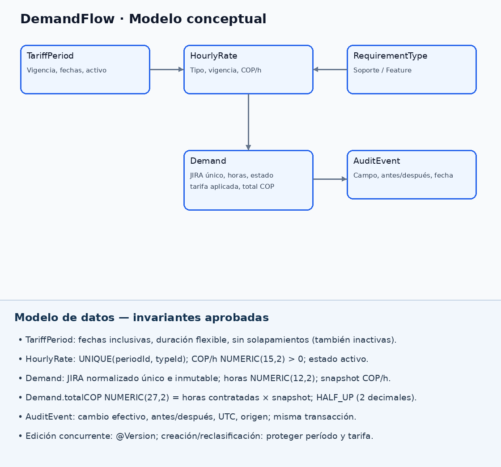

# Modelo conceptual de datos
**Estado:** Línea base funcional y arquitectónica v1.0 aprobada; diseño físico pendiente de implementación, aún no autorizada.

[Editar modelo en Excalidraw](diagrams/data-model.excalidraw)

## Entidades
| Entidad | Campos conceptuales | Invariantes |
|---|---|---|
| TariffPeriod | id, label, startDate, endDate, active | Intervalos sin solape; fechas inclusivas |
| RequirementType | id, code, name | Códigos Soporte y Feature |
| HourlyRate | id, periodId, typeId, amountCOP, active | Una por combinación tipo/vigencia (incluidas inactivas); valor estrictamente positivo |
| Demand | id, jiraKey, typeId, periodId, rateId, appliedHourlyRateCOP, estimatedHours, contractedHours, totalCOP, active | JIRA único global; snapshot monetario; horas no negativas |
| AuditEvent | id, entityType, entityId, field, before, after, occurredAt, actorOrigin | Inmutable desde CRUD; fecha y trazabilidad |

## Relaciones
- TariffPeriod 1:N HourlyRate.
- RequirementType 1:N HourlyRate y 1:N Demand.
- HourlyRate 1:N Demand (referencia a tarifa utilizada, sin depender de su valor mutable).
- Demand 1:N AuditEvent; los cambios de tarifas también producen eventos.

## Decisiones de integridad
- Un índice único sobre la clave JIRA normalizada, **incluyendo inactivos**.
- Unicidad de tarifa `(periodId, typeId)`.
- Impedir solapamientos de períodos activos e inactivos con validación de aplicación y restricción de exclusión GiST en PostgreSQL sobre rangos de fechas inclusivos.
- Nunca eliminar físicamente registros históricos desde la UI.
- Totales derivados de registros filtrados; no persistir agregados redundantes en MVP.

## Decisiones de refinamiento ya resueltas
Las escalas decimales, las políticas de edición de períodos usados, el origen sin autenticación y la normalización JIRA se detallan a continuación. No se consideran asuntos abiertos. La definición física de índices, bloqueos y eventos se verificará durante el diseño técnico.

## Complemento de auditoría (ADR-006 aceptado)

`AuditEvent` registra entidad afectada, identificador, operación, instante UTC, origen y valores anteriores/posteriores relevantes. Los eventos son de solo adición en los flujos ordinarios de la aplicación y se persisten en la misma transacción que el cambio. El snapshot `Demand.appliedHourlyRateCOP` es independiente de los eventos y del catálogo de tarifas. La forma física del registro de diferencias, los índices y la estrategia de concurrencia se definirán durante el diseño detallado, sin alterar los requisitos funcionales aprobados.

[Diagrama del flujo transaccional de auditoría](diagrams/audit-transaction.png) · [Editar en Excalidraw](diagrams/audit-transaction.excalidraw)

## Refinamientos funcionales integrados (aprobados)

Este apartado integra las precisiones anteriormente mantenidas en `data-model-refinements.md`. Forma parte del mismo modelo; no constituye una versión documental adicional.

### TariffPeriod — vigencias

- `startDate` y `endDate` son inclusivas, con `startDate <= endDate`. La duración es flexible, no exclusivamente anual (RF-PER-004; refinamiento de RN-001).
- Ninguna vigencia, activa o inactiva, puede solaparse con otra; se permiten períodos adyacentes sin compartir fechas. Se exige validación de aplicación y exclusión de rangos en PostgreSQL (RF-PER-002, RF-CON-004).
- No se pueden modificar fechas si existe cualquier demanda vinculada, activa o inactiva (RF-PER-001).
- Se permite desactivar y reactivar una vigencia con demandas históricas, sin cambiar snapshots ni reactivar automáticamente sus tarifas. Una vigencia inactiva no es elegible para nuevas demandas; la reactivación valida integridad (RF-PER-003).

### RequirementType — tipos

- Catálogo inicial fijo: `Soporte` y `Feature`. Se utiliza como referencia para tarifas y demandas.

### HourlyRate — tarifas

- Existe **como máximo un registro por `(periodId, typeId)`**, incluso si está inactivo; restricción `UNIQUE` física (RF-TAR-002).
- `amountCOP` utiliza `NUMERIC(15,2)`, obligatorio y estrictamente mayor que cero (RF-MON-001, RF-MON-004).
- La edición de una tarifa usada está permitida, se audita y afecta únicamente a demandas futuras o reclasificadas; no recalcula snapshots históricos (RF-TAR-001).
- La reactivación de una tarifa requiere que su vigencia esté activa. Desactivar una tarifa no cambia demandas anteriores (RF-TAR-003).
- La tarifa efectiva debe releerse y protegerse transaccionalmente al guardar una nueva demanda o cambiar su tipo/vigencia (RF-TAR-004, RF-CON-002).

### Demand — demandas y economía

- `jiraKey`: obligatorio, inmutable después de crear, único globalmente incluidos inactivos, máximo 50 caracteres. Normalizar quitando espacios exteriores y pasando a mayúsculas; patrón `^[A-Z][A-Z0-9_]*-[0-9]+$` y sufijo numérico positivo. Se conservan ceros iniciales, que distinguen claves. `project` se deriva del prefijo JIRA (RF-JIRA-001..006; refinamiento de RN-031).
- `estimatedHours` y `contractedHours`: `NUMERIC(12,2)`, obligatorios, >= 0, máximo dos decimales; cero permitido (RF-MON-001, RF-MON-004).
- `appliedHourlyRateCOP`: snapshot `NUMERIC(15,2)` no editable directamente, independiente del valor mutable del catálogo (RF-DEM-001, RF-DEM-002).
- `totalCOP`: `NUMERIC(27,2)`, derivado de `contractedHours × appliedHourlyRateCOP` mediante `BigDecimal`; redondeo **una sola vez**, tras multiplicar, a dos decimales `HALF_UP`. No se edita manualmente (RF-MON-002, RF-DEM-001).
- Cambiar solo horas estimadas no modifica el importe. Cambiar horas contratadas recalcula con el snapshot anterior, incluso si la tarifa o vigencia está inactiva. Cambiar tipo o vigencia exige una tarifa activa de la combinación final y actualiza snapshot e importe (RF-DEM-001, RF-TAR-003).
- Desactivación lógica: preserva JIRA, economía e histórico; una demanda inactiva no puede editarse hasta restaurarse. La restauración se permite aunque la vigencia o tarifa histórica esté inactiva, sin recalcular (RF-DEM-003, RF-DEM-004).
- Incluir `createdAt` (fechaCreacion) e `id` para orden determinista por defecto `createdAt DESC, id DESC` y paginación en servidor: tamaño inicial 20, opciones 10/20/50/100 (RF-CONSU-001..004).
- Filtros combinables; inactivas excluidas por defecto. Las sumas de horas estimadas, contratadas y COP cubren **todos** los registros filtrados, no solo la página visible, y el importe total suma valores persistidos ya redondeados (RF-CONSU-003).
- Las entidades editables deben protegerse con concurrencia optimista `@Version`; rechazar actualizaciones obsoletas (RF-CON-001).

### AuditEvent — trazabilidad

- Eventos inmutables con entidad, identificador, operación, campo/valores antes-después relevantes, instante UTC y origen `LOCAL_USER` o `SYSTEM`, según corresponda (ADR-006, RF-DEM-005).
- Guardar cambio de negocio y auditoría en la **misma transacción**; ante fallo de auditoría se revierte todo. No registrar eventos para guardados sin cambios efectivos; rechazar transiciones de estado redundantes con mensaje comprensible (RF-CON-003, RF-DEM-005).
- La estructura exacta de eventos por campo y los índices se especificarán en diseño técnico sin cambiar estas invariantes.

### Restricciones físicas y comprobaciones

- Índices/restricciones de unicidad: clave JIRA normalizada, `(periodId, typeId)` en tarifas, incluyendo inactivos.
- Restricción PostgreSQL de exclusión de intervalos inclusivos sobre vigencias activas e inactivas; migración Flyway y pruebas de concurrencia.
- Integridad de catálogo, snapshots y auditoría mediante transacciones y bloqueos consistentes; verificar orden de adquisición y errores de concurrencia.
- Validar límites `NUMERIC(12,2)`, `NUMERIC(15,2)`, `NUMERIC(27,2)` y redondeo `HALF_UP` con pruebas unitarias y de integración.
- Errores de unicidad JIRA, vigencia solapada, tarifa no disponible, actualización obsoleta y fallo de auditoría deben presentarse sin filtrar detalles SQL (RF-CON-005).

**Alcance gráfico:** se conservan los diagramas conceptuales Excalidraw y PNG originales, que no deben interpretarse como esquemas físicos exhaustivos. Su actualización gráfica se realizará cuando se apruebe el diseño físico.
