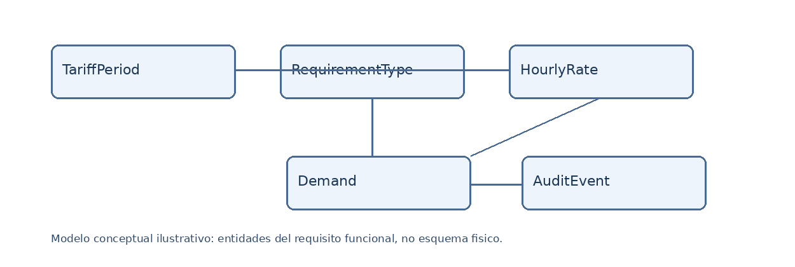

<!-- Especificación operativa integrada. El DOCX histórico se conserva como evidencia de levantamiento, no como norma vigente. -->

> **Estado:** Línea base funcional y arquitectónica v1.0 aprobada; implementación aún no autorizada.
> **Documento vigente de trabajo:** este Markdown, junto con [business-rules.md](business-rules.md). El [DOCX histórico](../reference/DemandFlow_Requisitos_Funcionales_v1.0.docx) se conserva sin modificaciones.

# DemandFlow

**Documento de requisitos funcionales · Línea base v1.0 aprobada**

Origen del levantamiento: 13 de noviembre de 2026 | Estado: Línea base funcional y arquitectónica v1.0 aprobada.

## 1. Control del documento

| Campo | Definición |
| --- | --- |
| Producto | DemandFlow |
| Versión | 1.0 |
| Estado | Línea base funcional y arquitectónica v1.0 aprobada |
| Origen | Entrevista de refinamiento y Excel anonimizado como referencia de proceso |
| Método previsto | SDD + OpenSpec, desde el inicio del desarrollo |
| Restricción | No se autoriza implementación, generación de código ni inicialización OpenSpec en esta etapa |

## 2. Propósito y alcance

Aplicación web sencilla para registrar y consultar la demanda económica de requerimientos de ingeniería Full Stack clasificados en Soporte o Feature. Cada demanda se identifica mediante un ID JIRA único, registra horas estimadas y contratadas y calcula su valor en COP a partir de una tarifa horaria asociada al tipo y vigencia seleccionados.

### 2.1 Incluido en MVP

- CRUD de vigencias tarifarias y tarifas por tipo.
- Registro, consulta, modificación, desactivación lógica y restauración de demandas.
- Cálculo económico y preservación de tarifa aplicada en cada demanda.
- Auditoría de modificaciones de demanda y tarifas.
- Listado con filtros por proyecto, tipo, vigencia y estado, más totales de horas y COP.
### 2.2 Fuera de alcance

- Importación de datos históricos del Excel.
- Exportación Excel/CSV.
- Integración con API JIRA.
- Autenticación y autorización por roles en el MVP.
- Dashboards avanzados y microservicios.
## 3. Conceptos del dominio

| Concepto | Definición |
| --- | --- |
| Tipo | Soporte o Feature; catálogo inicial fijo. |
| Vigencia | Período tarifario de duración flexible, con etiqueta y fechas inclusivas configurables, sin solapamientos (RF-PER-004). |
| Tarifa | Valor COP por hora para un tipo y una vigencia. |
| Demanda | Registro único de un requerimiento JIRA, horas y cálculo económico. |
| Tarifa aplicada | Valor COP/h capturado al calcular la demanda, independiente de cambios posteriores en catálogo. |
| Auditoría | Eventos inmutables que documentan modificaciones, estado y valores anteriores/nuevos. |

## 4. Reglas de negocio consolidadas

| ID | Regla |
| --- | --- |
| RN-001 | Las tarifas corresponden a vigencias definidas de duración flexible, con fechas inclusivas y sin solapamiento (RF-PER-004). *Texto original: «Las tarifas corresponden a vigencias anuales definidas».* |
| RN-002 | Cada ID JIRA identifica una sola demanda; duplicados se rechazan. |
| RN-003 | Cada tarifa corresponde a un tipo y una vigencia. |
| RN-004 | No se permiten tarifas duplicadas para la misma combinación tipo-vigencia. |
| RN-005 | Demanda final COP = horas contratadas × tarifa aplicada. |
| RN-006 | Cada demanda conserva la tarifa utilizada para su cálculo. |
| RN-007 | La edición de horas contratadas recalcula y registra auditoría. |
| RN-008 | La eliminación de demanda es lógica. |
| RN-009 | La unicidad de ID JIRA no distingue mayúsculas/minúsculas. |
| RN-010 | Cada vigencia tiene fechas de inicio y fin configurables. |
| RN-011 | La vigencia se selecciona explícitamente al registrar la demanda. |
| RN-012 | Las horas admiten valores decimales. |
| RN-013 | Se permite editar horas contratadas. |
| RN-014 | Editar horas contratadas recalcula la demanda final. |
| RN-015 | Las modificaciones de horas contratadas se auditan. |
| RN-016 | La eliminación desde el CRUD no borra físicamente la demanda. |
| RN-017 | Las demandas inactivas conservan información e historial. |
| RN-018 | La auditoría conserva fecha/hora del cambio. |
| RN-019 | La auditoría conserva campo, valor anterior y nuevo. |
| RN-020 | Cuando exista autenticación, se conserva usuario responsable; antes, origen no verificado. |
| RN-021 | No se requiere importar el Excel histórico. |
| RN-022 | La demanda se registra manualmente. |
| RN-023 | Listado filtrable por proyecto, tipo, vigencia y estado. |
| RN-024 | Mostrar totales de horas estimadas, contratadas y COP. |
| RN-025 | Sin exportación inicial. |
| RN-026 | Se permite corregir tarifas existentes. |
| RN-027 | Corregir tarifa no recalcula demandas existentes. |
| RN-028 | Las correcciones de tarifas se auditan. |
| RN-029 | No se guarda demanda sin tarifa disponible y activa. |
| RN-030 | Horas contratadas ≥ 0. |
| RN-031 | La clave JIRA cumple `PROYECTO-NÚMERO`, patrón normalizado `^[A-Z][A-Z0-9_]*-[0-9]+$`, número positivo, y demás validaciones RF-JIRA-001..006. *Texto original: «ID JIRA admite letras, números, guiones y guiones bajos».* |
| RN-032 | ID JIRA único sin distinción de mayúsculas/minúsculas, incluso si inactivo. |
| RN-033 | Horas estimadas obligatorias y ≥ 0. |
| RN-034 | Cambio de tipo permitido mediante edición explícita. |
| RN-035 | Cambio de vigencia permitido mediante edición explícita. |
| RN-036 | Cambio de tipo/vigencia exige nueva tarifa, recalcula y audita. |
| RN-037 | ID JIRA inmutable después del registro. |
| RN-038 | Demanda inactiva puede reactivarse. |
| RN-039 | La reactivación se audita. |
| RN-040 | Vigencias no pueden solaparse en sus fechas. |
| RN-041 | Tarifas y vigencias pueden desactivarse; conservar histórico y bloquear uso en nuevas demandas. |

## 5. Políticas de cálculo y consistencia

- La vigencia se elige manualmente y la tarifa se obtiene por combinación tipo-vigencia.
- Al cambiar solo horas, se recalcula con la tarifa aplicada previamente almacenada, aun si el catálogo cambió.
- Al cambiar tipo o vigencia, se obtiene una nueva tarifa activa; se actualizan tarifa aplicada e importe y se audita.
- Las tarifas y vigencias desactivadas no son seleccionables para nuevos registros ni para reasignaciones que requieran una nueva tarifa.
- La desactivación de una tarifa o vigencia no modifica demandas existentes.
- La reactivación de una tarifa o vigencia debe validar nuevamente unicidad, solapamientos y consistencia.
- Las fechas de inicio y fin de vigencia son inclusivas (RF-PER-002/004, aprobado).
## 6. Historias de usuario y criterios de aceptación

### HU-001 — Administrar vigencias

Como responsable del catálogo quiero crear, consultar, editar y desactivar vigencias para organizar tarifas.

- Aceptar etiqueta y fechas válidas, con inicio no posterior al fin.
- Rechazar períodos superpuestos.
- Permitir desactivar conservando datos y referencias históricas.
- No ofrecer vigencias inactivas para nuevos registros.
### HU-002 — Administrar tarifas

Como responsable del catálogo quiero mantener tarifas COP/h por tipo y vigencia.

- Exigir combinación tipo-vigencia única.
- Exigir tarifa estrictamente positiva; no se admite cero (RF-MON-004).
- Corregir tarifa con auditoría, sin recalcular demandas existentes.
- Desactivar y reactivar respetando integridad histórica.
### HU-003 — Registrar demanda

Como usuario quiero registrar un requerimiento y calcular su demanda económica.

- Exigir ID JIRA, tipo, vigencia, horas estimadas y contratadas.
- Rechazar duplicados de ID JIRA, incluso si inactivos, ignorando diferencias de mayúsculas.
- Aceptar horas decimales no negativas, incluido cero.
- Rechazar ausencia de tarifa activa.
- Guardar tarifa aplicada y resultado COP.
### HU-004 — Modificar demanda

Como usuario quiero editar horas, tipo y vigencia para mantener el cálculo correcto.

- Impedir editar ID JIRA.
- Recalcular con tarifa histórica cuando cambian solo horas.
- Recalcular con tarifa nueva cuando cambia tipo o vigencia.
- Rechazar cambio a combinación sin tarifa activa.
- Registrar auditoría de campos e importes afectados.
### HU-005 — Desactivar y restaurar

Como usuario quiero desactivar y reactivar demandas sin perder histórico.

- Desactivar sin borrado físico.
- Excluir inactivos por defecto y permitir filtrarlos.
- Restaurar preservando ID único y auditar estado.
### HU-006 — Consultar auditoría

Como usuario quiero conocer modificaciones de demanda y tarifas.

- Mostrar fecha/hora, entidad, campo, valor anterior y nuevo.
- Registrar actor cuando exista autenticación; mientras tanto, origen no verificado.
- No permitir editar eventos desde el CRUD.
### HU-007 — Consultar demanda

Como usuario quiero buscar y filtrar registros.

- Buscar por ID JIRA y filtrar por proyecto, tipo, vigencia y estado.
- Combinar filtros.
- Mostrar horas, tarifa aplicada, importe y estado.
### HU-008 — Consultar totales

Como usuario quiero consultar sumatorias según filtros.

- Sumar horas estimadas, horas contratadas y COP de resultados filtrados.
- Excluir inactivos por defecto.
- Sumar todos los registros filtrados, no solo página visible.
## 7. Modelo conceptual preliminar

| Entidad | Atributos conceptuales relevantes |
| --- | --- |
| TariffPeriod | id, etiqueta, fechaInicio, fechaFin, activo |
| RequirementType | id, código (Soporte/Feature), nombre |
| HourlyRate | id, vigenciaId, tipoId, valorHoraCOP, activo |
| Demand | id, jiraKey, tipoId, vigenciaId, tarifaId, horasEstimadas, horasContratadas, valorHoraAplicadoCOP, demandaFinalCOP, activo |
| AuditEvent | id, entidad, entidadId, campo, valorAnterior, valorNuevo, fechaHora, origen/actor |

[Diagrama editable de diseño (propuesta)](../architecture/diagrams/data-model.excalidraw)

*Figura 1. Representación visual reconstruida a partir de la tabla conceptual de este documento; no es una copia recuperada del gráfico original. Esquema no físico.*

Las relaciones y restricciones aprobadas se describen en [data-model.md](../architecture/data-model.md). Los detalles físicos y de implementación se validarán en diseño técnico y OpenSpec cuando se autorice la implementación.

## 8. Requisitos no funcionales propuestos

| ID | Requisito |
| --- | --- |
| RNF-001 | PostgreSQL en Docker; backend Java con Spring Boot. |
| RNF-002 | Cálculos exactos mediante BigDecimal/NUMERIC, sin double para dinero. |
| RNF-003 | Unicidad JIRA y tipo-vigencia reforzada en base de datos. |
| RNF-004 | Modificación y auditoría en la misma transacción. |
| RNF-005 | Pruebas unitarias y de integración para reglas económicas e integridad. |
| RNF-006 | Interfaz web sencilla y usable en escritorio. |
| RNF-007 | Uso local inicial; no exponer públicamente sin autenticación y controles. |
| RNF-008 | Trazabilidad entre HU, RN, escenarios OpenSpec y pruebas. |

## 9. Matriz de trazabilidad preliminar

| Historia | Reglas clave | Cambio OpenSpec previsto |
| --- | --- | --- |
| HU-001 | RN-001, RN-010, RN-040, RN-041 | manage-tariffs |
| HU-002 | RN-003, RN-004, RN-026–029, RN-041 | manage-tariffs |
| HU-003 | RN-002, RN-005–006, RN-011–012, RN-029–033 | register-demand |
| HU-004 | RN-007, RN-013–015, RN-034–037 | maintain-demand |
| HU-005 | RN-016–017, RN-038–039 | maintain-demand |
| HU-006 | RN-018–020, RN-028 | audit-changes |
| HU-007 | RN-023, RN-032 | query-demand |
| HU-008 | RN-024 | query-demand |

## 10. Decisiones de refinamiento resueltas

Las cuestiones abiertas en el levantamiento inicial están resueltas mediante reglas aprobadas. Este cuadro sustituye las preguntas históricas, sin eliminar su trazabilidad.

| Tema original | Decisión vigente | Referencia |
| --- | --- | --- |
| Precisión de horas | Horas decimales hasta dos decimales; entradas con mayor escala se rechazan. | RF-MON-002/005 |
| Redondeo monetario | `BigDecimal`, un redondeo final a dos decimales `HALF_UP`. | RF-MON-003 |
| Tarifa cero | No permitida; tarifa estrictamente positiva. | RF-MON-004 |
| Edición de vigencias utilizadas | Bloqueada la modificación de fechas si existen demandas asociadas, activas o inactivas. | RF-PER-001/002 |
| Identificación del proyecto | Derivada del prefijo de JIRA normalizado. | RF-JIRA-001/005 |
| Reactivación de vigencia | Permitida bajo validación de integridad; no reactiva tarifas automáticamente. | RF-PER-003 |
| Edición de demanda inactiva | Requiere restauración previa. | RF-DEM-005 |
| Paginación y orden | Servidor, 20 por defecto; 10/20/50/100; `fechaCreacion DESC, id DESC`. | RF-CONSU-001/002 |
| Duración de vigencias | Flexible, no obligatoriamente anual. | RF-PER-004 (refina RN-001) |
| Estructura JIRA | Formato estricto proyecto-número. | RF-JIRA-001..006 (refina RN-031) |

Las **33 reglas complementarias aprobadas** están descritas íntegramente en [business-rules.md](business-rules.md) y vinculadas a las ocho HU en [traceability-matrix.md](traceability-matrix.md). Las 41 RN permanecen en la sección 4.

## 11. Plan de incrementos (no ejecutado)

| Incremento | Objetivo | Resultado verificable |
| --- | --- | --- |
| 1 | Estructura del proyecto, vigencias y tarifas | CRUD con validaciones y pruebas |
| 2 | Registro de demanda | Cálculo, unicidad y tarifa aplicada |
| 3 | Mantenimiento y auditoría | Edición, desactivación, restauración, historial |
| 4 | Consultas y totales | Filtros y sumatorias consistentes |

La implementación requiere autorización separada. Los nombres de cambios son propuestas, no carpetas creadas.

## 12. Lista histórica de revisión y aprobación

- Confirmar que el alcance refleja el proceso real de registro de demanda.
- Revisar criterios de aceptación HU-001 a HU-008.
- Verificar que las decisiones ya resueltas de la sección 10 se reflejen coherentemente en arquitectura, modelo y pruebas.
- Aprobar formalmente el conjunto documental integrado antes de publicar la primera línea base y autorizar por separado el inicio de SDD + OpenSpec. La línea base v1.0 fue aprobada; la implementación aún requiere autorización separada.

**Estado actual:** Línea base funcional y arquitectónica v1.0 aprobada, identificada con el tag `v1.0.0-docs`. La implementación aún no está autorizada y no se ha generado código.

## 13. Trazabilidad del levantamiento histórico

El documento de origen, [DemandFlow_Requisitos_Funcionales_v1.0.docx](../reference/DemandFlow_Requisitos_Funcionales_v1.0.docx), se conserva intacto como evidencia histórica, **no** como versión oficial vigente. RN-001 y RN-031 muestran su redacción original y el refinamiento aprobado. La única especificación funcional operativa es la combinación de este documento y [business-rules.md](business-rules.md), con la [matriz de trazabilidad](traceability-matrix.md).
